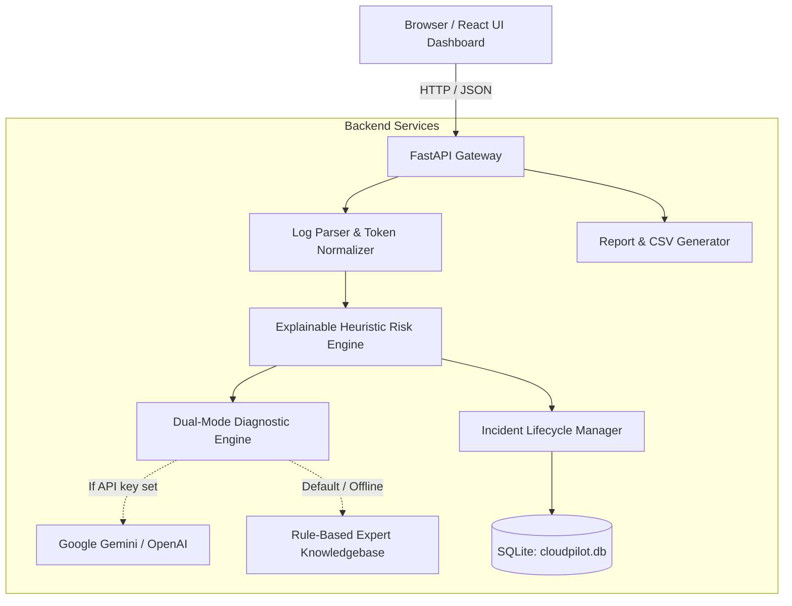

# CloudPilot AI — AI-Powered Cloud Operations Assistant

> Autonomous cloud infrastructure diagnostics, multi-format log analysis, error clustering, and explainable failure risk assessment.

---

## 1. Overview

**CloudPilot AI** is an enterprise-grade cloud operations assistant engineered for DevOps and Site Reliability Engineering (SRE) teams. It inspects application, container, and infrastructure logs to rapidly identify operational anomalies, isolate root causes, quantify failure risks, and recommend concrete, prioritized remediation procedures.

### Core Highlights
* **Multi-Format Log Parser**: Ingests `.log`, `.txt`, and `.json` logs (Kubernetes, Docker, Syslog, Web Proxies, and custom application streams).
* **Dynamic Pattern Clustering**: Normalizes dynamic tokens (IPs, UUIDs, hex memory pointers, timestamps) to cluster repeating root-cause signatures.
* **Dual-Mode Intelligence**:
  * **AI-Powered Mode**: Integrates with Google Gemini 1.5 or OpenAI GPT-4o-mini when an API key is provided.
  * **Rule-Based Heuristic Expert Mode**: Offline, deterministic engine covering 15+ real-world cloud failure patterns with 0 external API dependencies.
* **Explainable 100-Point Risk Engine**: Mathematical scoring based on critical severity (40%), error burst velocity (30%), service blast radius (15%), and catastrophic failure signatures (15%).
* **Incident Registry**: Persistent SQLite tracking of operational outages with unique tracking codes (`INC-1001`), triage status workflows (`Open`, `Investigating`, `Resolved`), and notes.
* **Executive Reports & Export**: One-click downloads of CSV pattern summaries, Markdown executive briefs, and printable PDF documents.
* **1-Click Simulation Library**: Built-in realistic failure logs for live college demonstrations (Kubernetes OOMKilled & CrashLoopBackOff, PostgreSQL Connection Pool Exhaustion, Auth Gateway Timeout, and Healthy Steady-State).

---

## 2. Technology Stack & Prerequisites

### Prerequisites
* **Python**: 3.10 or higher (Tested on Python 3.11.9)
* **Node.js**: 18.0 or higher (Tested on Node.js v24.14.0, npm 11.9.0)
* **Git**: Any modern version
* **Operating System**: Windows, macOS, or Linux

### Technologies

| Layer | Technologies |
|---|---|
| **Backend API** | Python 3.11, FastAPI, Uvicorn, Pydantic v2 |
| **Data & Persistence** | SQLite, SQLAlchemy 2.0 |
| **Diagnostics & Rules** | Dual-Mode Heuristic Engine + Google Gemini / OpenAI |
| **Testing** | Pytest, Pytest-Asyncio, Starlette TestClient, HTTPX |
| **Frontend UI** | React 18, Vite 5, Tailwind CSS |
| **Visualization** | Recharts (Donut & Bar charts), Lucide Icons |
| **Design Language** | Enterprise SaaS: Dark navy sidebar (`#0b1329`), soft blue (`#38bdf8`), and teal (`#0d9488`) |

---

## 3. Architecture



---

## 4. Quick Start (Windows PowerShell)

### One-Click Launch
From the `cloudpilot-ai` folder, run:
```powershell
powershell -ExecutionPolicy Bypass -File .\run-all.ps1
```
This automatically launches:
* **Backend API & Swagger Docs**: `http://localhost:8000/docs`
* **Frontend Dashboard**: `http://localhost:5173`

---

### Manual Launch

#### 1. Start Backend API
```powershell
cd backend
python -m venv venv
.\venv\Scripts\pip install -r requirements.txt
$env:PYTHONPATH = ".."
.\venv\Scripts\python.exe -m uvicorn backend.main:app --host 0.0.0.0 --port 8000 --reload
```

#### 2. Start Frontend UI
```powershell
cd frontend
npm install
npm run dev
```

#### 3. Run Backend Test Suite
```powershell
powershell -ExecutionPolicy Bypass -File .\run-tests.ps1
# or:
$env:PYTHONPATH = "."
.\backend\venv\Scripts\pytest backend\tests -v
```

---

## 5. Deployment Information (Free-Tier & Production)

CloudPilot AI is designed for friction-free single-server deployment. When the frontend is built using `npm run build`, FastAPI automatically mounts and serves the static production bundle from `frontend/dist` directly at `http://localhost:8000/`.

### Deployment Options

1. **Unified Docker Container**:
   Build the frontend into `frontend/dist` and run the FastAPI application on any container service (Render, Railway, Fly.io, or AWS App Runner).
   ```dockerfile
   FROM python:3.11-slim
   WORKDIR /app
   COPY backend/requirements.txt .
   RUN pip install --no-cache-dir -r requirements.txt
   COPY backend ./backend
   COPY sample_logs ./sample_logs
   COPY frontend/dist ./frontend/dist
   ENV PYTHONPATH="/app"
   EXPOSE 8000
   CMD ["uvicorn", "backend.main:app", "--host", "0.0.0.0", "--port", "8000"]
   ```

2. **Render / Railway Web Service (Free Tier)**:
   - Build Command: `cd frontend && npm install && npm run build && cd ../backend && pip install -r requirements.txt`
   - Start Command: `PYTHONPATH=. uvicorn backend.main:app --host 0.0.0.0 --port $PORT`

---

## 6. College / Academic Demonstration Guide

Use this step-by-step walkthrough during your presentation:

1. **Dashboard Overview**:
   * Open `http://localhost:5173`.
   * Point out the **Dark Navy + Teal Enterprise SaaS Interface**, key performance indicators (Total Events, Critical Faults, Open Incidents), and the **Infrastructure Risk Meter**.
2. **Interactive 1-Click Simulation**:
   * Scroll down to **1-Click Realistic Cloud Failure Scenarios**.
   * Click **Simulate Failure** on **Kubernetes OOMKilled & CrashLoopBackOff**.
   * Watch the dashboard immediately update:
     * Risk Meter spikes to **CRITICAL (75-89/100)**.
     * Severity donut chart breaks down Critical/Error counts.
     * The Executive Diagnosis identifies **Linux cgroup memory limit enforcement (Exit Code 137)**.
3. **Deep Log Inspection**:
   * Navigate to the **Log Analyzer** tab.
   * Review the **Clustered Error Signatures** table. Explain how dynamic IDs, UUIDs, and IPs were normalized into `<UUID>`, `<IP>`, `<HEX>` to cluster repeating failures.
   * Toggle to the **Parsed Stream Sample** to view sequential line numbers, timestamps, and service tags.
4. **Explainable Risk Assessment**:
   * Switch to the **Risk Assessment** tab.
   * Highlight the **4-Factor Transparent Mathematical Breakdown**:
     * Critical Severity Impact (40%)
     * Error Velocity & Density (30%)
     * Service Blast Radius (15%)
     * Catastrophic Failure Fingerprints (15%)
   * Show the Prioritized Preventive Action checklist with exact `kubectl` remediation commands.
5. **Incident Lifecycle Management**:
   * Open the **Incidents** tab.
   * Show the auto-created incident (`INC-1001`).
   * Change status from `Open` to `Investigating` or `Resolved` via the live dropdown.
   * Click **Inspect** to view root causes, trigger telemetry, and operator investigation notes.
   * Click **Export Incidents CSV** to show instant data download.
6. **Executive Report & Print Deliverable**:
   * Open the **Reports & Export** tab.
   * Click **Print / PDF** to demonstrate printer-friendly corporate reporting styling.
   * Download the **Markdown** or **CSV** deliverable.
7. **Simulate Healthy Baseline**:
   * Return to Overview and click **Simulate Failure** on **Healthy Steady-State Traffic**.
   * Show the Risk Score dropping to **LOW (< 10/100)** with green badges confirming nominal SLOs.

---

## 7. API Reference

| Method | Endpoint | Description |
|---|---|---|
| `GET` | `/api/health` | Health status, database connectivity, and telemetry counts |
| `POST` | `/api/logs/analyze` | Upload `.log`/`.txt`/`.json` file or submit raw log text (25MB limit) |
| `GET` | `/api/logs/samples` | List pre-packaged realistic cloud failure logs |
| `POST` | `/api/logs/samples/{id}/load` | Load and analyze a realistic sample log stream |
| `GET` | `/api/incidents` | Query incident registry with status, severity, and search filters |
| `PATCH` | `/api/incidents/{id}` | Update incident status (`Open`, `Investigating`, `Resolved`) or notes |
| `DELETE` | `/api/incidents/{id}` | Delete an incident |
| `GET` | `/api/reports/latest` | Get latest analysis report |
| `GET` | `/api/reports/{id}/export/csv` | Download CSV of clustered error patterns |
| `GET` | `/api/reports/{id}/export/markdown` | Download Markdown executive report |
| `GET` | `/api/reports/export/incidents-csv` | Download CSV of all incidents |
| `GET` | `/api/settings` | Get configured settings (masked keys) |
| `POST` | `/api/settings` | Update AI provider, API keys, or sensitivity |
| `POST` | `/api/settings/reset-db` | Reset historical telemetry and incidents |

---

## 8. Testing & Quality Assurance

The project includes an automated backend test suite covering:
* Log parsing of Syslog, Kubernetes container logs, and JSON lines.
* Error message signature token normalization (`<IP>`, `<UUID>`, `<HEX>`, `<NUM>`).
* Explainable risk scoring boundary conditions (0 to 100).
* Rule-based heuristic expert engine fallback responses.
* Security validation: file size limit (25MB) and file extension whitelisting.
* API endpoints, empty file validation, and incident CRUD.

Run the test suite with:
```powershell
powershell -ExecutionPolicy Bypass -File .\run-tests.ps1
```
Result: **17/17 tests passing (100%)**.

---

## 9. License & Attribution

Designed and developed independently as **CloudPilot AI** for cloud operations observability and incident response demonstration.
